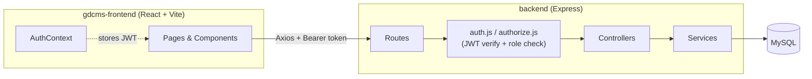

# Golden Dental Center Management System (GDCMS)

A full-stack clinic management system for a dental practice, built as the final semester project for an Object-Oriented Programming (OOP) course. It provides role-based access for **administrators** and **doctors** to manage patients, examinations, control schedules, and inter-doctor patient transfers.


---

## Table of Contents

- [Overview](#overview)
- [Key Features](#key-features)
- [Tech Stack](#tech-stack)
- [Project Architecture](#project-architecture)
- [Folder Structure](#folder-structure)
- [Getting Started](#getting-started)
- [Environment Variables](#environment-variables)
- [API Overview](#api-overview)
- [Demo Credentials](#demo-credentials)
- [Responsive Design](#responsive-design)
- [Performance Optimizations](#performance-optimizations)
- [Security Notes](#security-notes)
- [Future Improvements](#future-improvements)
- [Author](#author)
- [License](#license)

---

## Overview

GDCMS digitizes the day-to-day operations of a small dental clinic: patient intake, examination records, follow-up (control) scheduling, and reassigning patients between doctors — with a clear separation of what administrators and doctors are each allowed to do.

- **Administrators** manage the clinic as a whole: all patients, all doctors, examination and schedule records clinic-wide, and patient-to-doctor transfers.
- **Doctors** manage only the patients assigned to them: viewing their patient list, recording examinations, and scheduling follow-up controls.

## Key Features

### Administrator

- Secure login (JWT-based authentication)
- Dashboard with clinic-wide statistics
- Patient management (create, view, filter, search)
- Doctor management (create, edit profile, activate/deactivate, reset password)
- Clinic-wide examination records
- Clinic-wide control schedule overview
- Transfer patients between doctors, with full transfer history
- Reset a doctor's password on their behalf

### Doctor

- Secure login (JWT-based authentication)
- Personal dashboard (today's controls, recent examinations)
- View only their assigned patients
- Register new patients
- Record examinations (complaint, diagnosis, treatment, notes)
- Schedule and update follow-up control appointments
- "Forgot password" flow that routes to the administrator via WhatsApp (by design — see [Future Improvements](#future-improvements))

## Tech Stack

**Frontend**
- React 19 + Vite
- React Router DOM (protected & role-based routing)
- Tailwind CSS
- Axios
- Lucide React (icons)

**Backend**
- Node.js + Express 5
- JWT (`jsonwebtoken`) for stateless authentication
- `bcryptjs` for password hashing
- `mysql2` (parameterized queries, no ORM)
- `morgan` (request logging), `cors`, `dotenv`

**Database**
- MySQL 8

## Project Architecture

GDCMS is a two-app monorepo: a React SPA that talks to a stateless REST API over JWT-authenticated HTTP requests.



- **Authentication**: `POST /api/auth/login` validates credentials with `bcryptjs` and issues a JWT containing the user's `id`, `role_name`, `name`, and `email`. The frontend stores this token and attaches it as a `Bearer` header on every subsequent request (see `services/api.js`).
- **Authorization**: every protected route runs through `middleware/auth.js` (verifies the JWT) and `middleware/authorize.js` (checks the decoded role against the roles allowed for that route) before reaching a controller.
- **Data access**: controllers stay thin and delegate to a `services/` layer, which talks to MySQL through parameterized queries via a shared `mysql2` connection pool (`database/db.js`) — no ORM.
- **Frontend routing**: `routes/ProtectedRoute.jsx` guards any route behind authentication, and `routes/RoleRoute.jsx` further restricts `/admin/*` and `/doctor/*` route trees to the matching role.

## Folder Structure

```
GDCMS/
├── backend/
│   ├── config/              # Environment-driven app config
│   ├── controllers/         # Request/response handling per resource
│   ├── database/
│   │   ├── db.js            # mysql2 connection pool
│   │   ├── gdcms.sql        # Full schema + demo seed data (single-file setup)
│   │   └── generateHash.js  # CLI utility to generate bcrypt password hashes
│   ├── middleware/          # JWT authentication & role-based authorization
│   ├── routes/               # Express route definitions per resource
│   ├── services/            # Business logic + SQL queries
│   ├── .env.example
│   └── server.js            # App entry point
│
├── gdcms-frontend/
│   ├── src/
│   │   ├── components/
│   │   │   ├── layout/      # Sidebar, TopBar, DashboardLayout, PageTransition
│   │   │   └── ui/          # Reusable UI primitives (Button, Modal, Toast, Skeleton, forms...)
│   │   ├── context/         # AuthContext, ToastContext
│   │   ├── hooks/           # useAuth, useDebounce, useToast
│   │   ├── pages/
│   │   │   ├── admin/
│   │   │   ├── doctor/
│   │   │   └── auth/
│   │   ├── routes/          # AppRouter, ProtectedRoute, RoleRoute
│   │   ├── services/        # Axios API clients per resource
│   │   └── utils/
│   ├── .env.example
│   └── vite.config.js
│
├── .gitignore
├── LICENSE
└── README.md
```

## Getting Started

### Prerequisites

- [Node.js](https://nodejs.org/) 18 or later
- [MySQL](https://www.mysql.com/) 8.x (or MariaDB equivalent), and a client such as phpMyAdmin or the `mysql` CLI

### 1. Clone the repository

```bash
git clone https://github.com/<your-username>/gdcms.git
cd gdcms
```

### 2. Set up the database

Import the single schema + seed file — it creates the `gdcms` database, all tables, and a small demo dataset:

```bash
mysql -u root -p < backend/database/gdcms.sql
```

(Or open phpMyAdmin → Import → select `backend/database/gdcms.sql`.)

### 3. Configure and run the backend

```bash
cd backend
cp .env.example .env   # then fill in your local DB credentials and a JWT secret
npm install
npm run dev             # or: npm start
```

The API runs on `http://localhost:3000` by default.

### 4. Configure and run the frontend

```bash
cd gdcms-frontend
cp .env.example .env    # defaults to the local backend URL
npm install
npm run dev
```

The app runs on `http://localhost:5173` by default.

## Environment Variables

Neither `.env` file is committed — copy each `.env.example` and fill in your own values.

### `backend/.env`

| Variable         | Description                                   |
|------------------|------------------------------------------------|
| `PORT`           | Port the Express server listens on             |
| `DB_HOST`        | MySQL host                                     |
| `DB_PORT`        | MySQL port                                     |
| `DB_USER`        | MySQL username                                 |
| `DB_PASSWORD`    | MySQL password                                 |
| `DB_NAME`        | Database name (`gdcms`)                        |
| `JWT_SECRET`     | Secret used to sign/verify JWTs — use a long, random value |
| `JWT_EXPIRES_IN` | JWT expiry (e.g. `24h`)                        |

### `gdcms-frontend/.env`

| Variable              | Description                          |
|-----------------------|---------------------------------------|
| `VITE_API_BASE_URL`   | Base URL of the backend API           |

## API Overview

All endpoints are prefixed with `/api`. Protected routes require an `Authorization: Bearer <token>` header obtained from `/auth/login`.

| Method | Endpoint                              | Access         | Description                          |
|--------|----------------------------------------|----------------|---------------------------------------|
| POST   | `/auth/login`                          | Public         | Log in, returns JWT + user profile    |
| POST   | `/auth/forgot-password`                | Public         | Look up which role an email belongs to (for the WhatsApp recovery flow) |
| GET    | `/auth/profile`                        | Authenticated  | Get the current user's profile        |
| GET    | `/patients`                            | Admin, Doctor  | List patients (doctors see only their own) |
| GET    | `/patients/:id`                        | Admin, Doctor  | Get a single patient                  |
| POST   | `/patients`                            | Admin, Doctor  | Create a patient                      |
| PUT    | `/patients/:id`                        | Doctor         | Update a patient (own patients only)  |
| PUT    | `/patients/:id/status`                 | Doctor         | Update a patient's status             |
| GET    | `/examinations`                        | Admin, Doctor  | List examinations                     |
| GET    | `/examinations/patient/:patientId`     | Admin, Doctor  | List examinations for a patient       |
| POST   | `/examinations`                        | Doctor         | Create an examination record          |
| GET    | `/control-schedules`                   | Admin, Doctor  | List control schedules                |
| GET    | `/control-schedules/patient/:patientId`| Admin, Doctor  | List control schedules for a patient  |
| POST   | `/control-schedules`                   | Doctor         | Create a control schedule              |
| PUT    | `/control-schedules/:id`               | Doctor         | Update a control schedule status      |
| POST   | `/transfers`                           | Admin          | Transfer a patient to another doctor  |
| GET    | `/transfers`                           | Admin          | View transfer history                 |
| GET    | `/users`                               | Admin          | List all doctors                      |
| POST   | `/users`                               | Admin          | Create a doctor account               |
| PUT    | `/users/:id`                           | Admin          | Update a doctor's profile             |
| PUT    | `/users/:id/reset-password`            | Admin          | Reset a doctor's password             |
| PUT    | `/users/change-password`               | Doctor         | Change your own password              |
| PATCH  | `/users/:id/status`                    | Admin          | Toggle a doctor between ACTIVE/INACTIVE |
| DELETE | `/users/:id`                           | Admin          | Delete a doctor account               |

## Demo Credentials

The seed data in `backend/database/gdcms.sql` creates the following demo accounts (for local evaluation only — **do not reuse these credentials for a real deployment**):

| Role   | Email               | Password    |
|--------|---------------------|-------------|
| Admin  | `admin@gdc.com`     | `admin123`  |
| Doctor | `sarah@gdc.com`     | `dokter123` |
| Doctor | `michael@gdc.com`   | `dokter123` |

## Responsive Design

The interface is built mobile-first with Tailwind's breakpoint system and adapts across phone, tablet, laptop, and desktop widths:

- The sidebar collapses into a slide-in drawer with a backdrop on small screens, toggled from the top bar.
- Tables scroll horizontally within their own container instead of breaking the page layout.
- Dashboard grids, forms, cards, and modals reflow from single-column (mobile) to multi-column (desktop).
- Verified at common breakpoints (~390px mobile up to 1440px desktop) with no horizontal overflow.

## Performance Optimizations

- Route-based code splitting via `React.lazy` + `Suspense` — each page is loaded on demand.
- Debounced search inputs (`useDebounce`) so list filtering doesn't recompute on every keystroke.
- `useMemo` for derived/filtered lists and `React.memo` on table row components to avoid unnecessary re-renders.
- Skeleton loading states (tables, cards, stat values) instead of layout-shifting spinners.
- Lazy-loaded, fade-in images (`LazyImage`) for avatars and doctor photos to avoid layout shift.

## Security Notes

- Passwords are hashed with `bcryptjs` before being stored — plaintext passwords are never persisted.
- Authentication is stateless JWT; tokens are verified and role-checked on every protected route (`middleware/auth.js`, `middleware/authorize.js`).
- All SQL queries use parameterized placeholders (`?`) via `mysql2`, not string concatenation — this protects against SQL injection.
- Secrets (`JWT_SECRET`, database credentials) are read from environment variables and are never hardcoded in source. `.env` files are git-ignored; only `.env.example` placeholder files are committed.

## Future Improvements

Honest next steps, not yet implemented:

- Replace the WhatsApp-redirect "forgot password" flow with real email-based password reset.
- Doctor/patient photo upload (the UI already has an avatar slot ready for it).
- Pagination or virtualization for patient/examination tables at larger data volumes.
- Automated tests (unit/integration) for both the API and the frontend.
- JWT refresh tokens instead of a single long-lived access token.
- Server-side input validation layer (e.g. `express-validator` or `zod`) beyond the current manual checks.

## Author

**Mustafa**
Object-Oriented Programming (OOP) — Semester 4

Developed as a final semester project, and later polished for portfolio use.

## License

This project is licensed under the [MIT License](./LICENSE).
